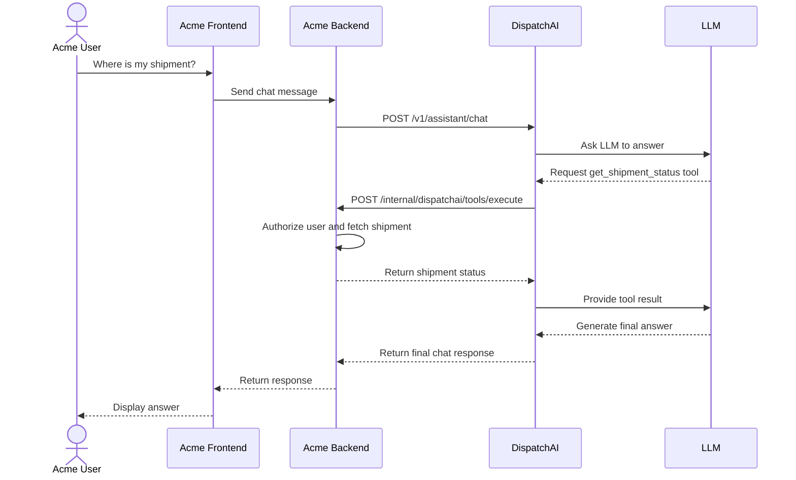

# DispatchAI

**DispatchAI is a host-agnostic AI dispatch and orchestration engine written in Go.** It lets an existing application expose selected capabilities to an LLM without moving its authentication, authorization, business rules, or transactional data into the AI layer.

> **DispatchAI orchestrates AI and tool interactions. The host application remains the source of business truth.**

A host application might be a logistics platform, fleet-management system, e-commerce service, customer-support application, or internal enterprise product. The host keeps ownership of its users, tenants, domain services, and data. DispatchAI manages the conversation and LLM workflow and coordinates approved tool calls.

## Contents

- [DispatchAI](#dispatchai)
  - [Contents](#contents)
  - [Why DispatchAI](#why-dispatchai)
  - [Core responsibility boundaries](#core-responsibility-boundaries)
  - [Architecture](#architecture)
  - [End-to-end chat flow](#end-to-end-chat-flow)
    - [What happens in order](#what-happens-in-order)
  - [How the host receives the answer](#how-the-host-receives-the-answer)
  - [Security model](#security-model)
    - [Required trust-boundary checks](#required-trust-boundary-checks)
  - [Integration lifecycle](#integration-lifecycle)
  - [API surface](#api-surface)
    - [Request idempotency](#request-idempotency)
  - [Request lifecycle and reliability](#request-lifecycle-and-reliability)
  - [Repository layout](#repository-layout)
  - [Technology and infrastructure](#technology-and-infrastructure)
  - [Configuration and local development](#configuration-and-local-development)
    - [Prerequisites](#prerequisites)
    - [Start local infrastructure](#start-local-infrastructure)
    - [Configure the application](#configure-the-application)
    - [Download dependencies and run](#download-dependencies-and-run)
    - [Apply migrations](#apply-migrations)
  - [Testing](#testing)
  - [Production checklist](#production-checklist)
    - [Known limitations to verify before relying on a feature](#known-limitations-to-verify-before-relying-on-a-feature)
  - [Guiding principle](#guiding-principle)

## Why DispatchAI

Without an orchestration layer, an application may need to build LLM calls, conversation management, tool selection, retries, and request tracking directly into its backend.

DispatchAI separates that AI workflow from the host's domain logic:

- **Host application:** authenticates users, establishes trusted identity and tenant context, owns domain services and data, and authorizes and executes business operations.
- **DispatchAI:** coordinates LLM requests, conversation context, registered tools, policy and idempotency checks, run/request state, and the final assistant response.
- **LLM provider:** interprets the conversation and may request a tool. Its output is untrusted input, not authorization and not a source of current business truth.

The host exposes only the capabilities it intends to make available. DispatchAI coordinates those capabilities; it does not replace the host's business backend.

## Core responsibility boundaries

| Concern | Owner | Responsibility |
|---|---|---|
| User authentication | Host application | Authenticate the actual user |
| Tenant and user identity | Host application | Establish and validate trusted context |
| Domain authorization | Host application | Decide whether the user can access or change a resource |
| Business rules | Host application | Validate domain constraints and state transitions |
| Business database | Host application | Own transactional records and authoritative data |
| Tool definitions and routing | DispatchAI, configured with the host | Describe and coordinate exposed capabilities |
| LLM orchestration | DispatchAI | Send context to the model and handle tool-call cycles |
| Conversation and run state | DispatchAI | Track the assistant workflow and persist supported state |
| Request/tool idempotency | DispatchAI and host | Coordinate retries; host must protect external side effects too |
| Final response delivery | DispatchAI → host → frontend | Return the result through the original HTTP request |

**The LLM never becomes the source of business truth.** For a question such as “Where is my shipment?”, the host's shipment service must return the authoritative status. The LLM can then explain that result in natural language.

## Architecture

```text
┌──────────────────────── HOST APPLICATION ────────────────────────┐
│                                                                  │
│  Frontend · User authentication · Tenant context                 │
│  Authorization · Business rules · Domain services                │
│  Transactional database · External business systems              │
│  Host-owned tool execution endpoint                               │
│                                                                  │
└─────────────────────────────┬────────────────────────────────────┘
                              │ signed API request / trusted context
                              ▼
┌────────────────────────────── DISPATCHAI ─────────────────────────┐
│                                                                  │
│  API authentication and permission checks                        │
│             │                                                    │
│             ▼                                                    │
│  Request idempotency ── Run lifecycle ── Conversation storage     │
│             │                                                    │
│             ▼                                                    │
│  Orchestrator ───────────────────────────────► LLM provider       │
│       │                                          │                │
│       │              final answer ◄──────────────┤                │
│       │              or tool calls              │                │
│       ▼                                          │                │
│  Tool registry / policy / executor               │                │
│       │                                                           │
└───────┼───────────────────────────────────────────────────────────┘
        │ tool execution request
        ▼
┌──────────────────────── HOST TOOL GATEWAY ────────────────────────┐
│  Authenticate caller · Authorize user/tenant · Validate arguments │
│  Apply business rules · Execute domain service · Return result    │
└───────────────────────────────────────────────────────────────────┘
```

The host tool gateway is an integration boundary. A route name used in an example below is illustrative unless it matches the route implemented by your host application and configured in DispatchAI.

## End-to-end chat flow

The following sequence shows the intended interaction for an Acme logistics application. It includes the tool round-trip and, importantly, the return of the final answer to the backend that initiated the chat request.



### What happens in order

1. The user submits a message in the frontend.
2. The frontend sends it to the Acme backend. Acme authenticates the user and determines trusted user/tenant context.
3. The backend sends the chat request to DispatchAI with the required integration authentication/signature, permission context, and idempotency key expected by the configured API.
4. DispatchAI validates the request and its authorization context, checks request idempotency, and starts or resumes the supported request/run flow.
5. DispatchAI sends the conversation and available tool definitions to the configured LLM provider.
6. The model may request `get_shipment_status`. This is only a proposed action; it is not proof that the user is allowed to access that shipment.
7. DispatchAI coordinates the tool call through its registry, policy, and idempotency safeguards, then calls the host's configured tool gateway.
8. The host validates the request independently, authorizes access to the shipment, reads its own data source, and returns a structured tool result.
9. DispatchAI passes that result back to the LLM. The model generates a user-facing answer grounded in the tool result.
10. DispatchAI persists the supported conversation/request outcome and returns the final chat response in the original HTTP response.
11. The Acme backend returns that response to the frontend, which displays it to the user.

**Important:** `/internal/dispatchai/tools/execute` is an example host-side gateway path for this diagram. It must be implemented by the host and configured to match the actual tool-execution contract. Do not assume this exact route is created automatically by DispatchAI.

## How the host receives the answer

In the synchronous chat flow, the host normally receives the final answer as the response to the same HTTP request it made to DispatchAI. It does not need a separate callback merely to receive that answer.

Conceptually, the exchange is:

```text
Acme Backend ── POST chat request ──► DispatchAI
Acme Backend ◄── final chat response ─ DispatchAI
```

The following JSON is only an **illustrative shape**, not a promise of the exact current response schema. Use the response model implemented by the checked-out version of DispatchAI:

```json
{
  "request_id": "request-uuid",
  "run_id": "run-uuid",
  "conversation_id": "conversation-uuid",
  "answer": "Your shipment is in transit and is expected to arrive tomorrow."
}
```

A host client should check the HTTP status, handle non-success responses, and decode the response into a type that matches the actual API contract. It should not assume that a response is successful merely because a body was received.

## Security model

The integration uses signed requests for protected integration endpoints. The current design uses integration identity and key identity headers, with ECDSA P-256 signatures using SHA-256. The exact canonicalization rules and required headers must match the implementation in the authentication package.

At a high level:

1. An integration is provisioned through the administrative onboarding flow.
2. The host generates and retains its private signing key.
3. DispatchAI stores the corresponding public key and associates it with the integration/key identity.
4. The host signs each protected request according to DispatchAI's canonical request format.
5. DispatchAI verifies the signature and checks the integration's status and required permissions.

Never send a private signing key to DispatchAI. Never commit private keys, tokens, API credentials, `.env` files, or production secrets to source control.

Signing authenticates the integration request; it does **not** replace the host's end-user authorization. The host must still decide whether the authenticated user can access a shipment, order, account, or other resource. Do not trust arbitrary `user_id`, `tenant_id`, roles, or permissions supplied in a request body unless they have been established or verified through a trusted mechanism.

### Required trust-boundary checks

- Verify the signed request and its canonicalization, timestamp/nonce protections if implemented, and key identity.
- Reject suspended or otherwise ineligible integrations.
- Check the integration's granted permission for the requested API operation.
- Validate every tool name and argument against the registered definition.
- Independently authorize the end user and tenant in the host gateway.
- Avoid logging signing material, bearer tokens, private data, or unrestricted tool payloads.
- Apply timeouts, request-size limits, rate limits, and network restrictions appropriate to the deployment.

## Integration lifecycle

The onboarding and authorization model separates integration status from permissions.

The intended lifecycle is:

```text
Admin creates integration
        │
        ▼
Pending integration + short-lived enrollment token
        │
        ▼
Host enrolls a public signing key
        │
        ▼
Admin activates integration
        │
        ▼
Active integration ─────────► Admin suspends integration
        ▲                                  │
        └──────── Admin reactivates ───────┘
```

An enrollment token is time-limited and is intended for the enrollment operation, not as a permanent request credential. A host should store its private key securely and use the matching key ID when signing requests.

Permission grants are separate from lifecycle state. Granting a permission must not implicitly activate an integration; a pending or suspended integration should remain unable to use protected endpoints until its status permits access.

Exact administrative request bodies, token formats, and response fields should be taken from the current API handlers and models. Do not copy guessed fields into a production client.

## API surface

The repository's current API areas include the following route groups. Confirm the exact HTTP methods, request schemas, and middleware in the checked-out router before wiring a client; route names alone do not define a complete contract.

| API area | Purpose |
|---|---|
| `POST /v1/assistant/chat` | Submit a chat request and receive the final assistant response synchronously |
| `/v1/integrations/enroll` | Enroll an integration signing key using the enrollment flow |
| `/v1/integrations/tools` | Manage or access registered tool definitions through the protected integration API |
| `/v1/admin` | Administrative integration lifecycle and permission operations |
| `/v1/conversation/conversation` | Conversation-related operations, subject to the routes registered in the current version |
| `/v1/conversation/conversation/:conversation_id` | Access a conversation-specific resource, subject to the registered method and middleware |
| `/v1/conversation/chat` | Conversation/chat route if registered by the current router; verify its exact relationship to the assistant endpoint before using it |

The route groups above reflect the project API areas, not a substitute for the actual router. In particular, verify whether `/v1/assistant/chat` and the conversation-prefixed chat route are both enabled in the current build and whether they share the same handler.

### Request idempotency

For chat requests, send a stable `Idempotency-Key` for retries of the same logical operation when the endpoint requires it. Reuse the same key only for the same request. A request key should not be reused for a different message or different request context.

The server may return a conflict for a request that is still in progress, and it should reject key reuse when the request fingerprint differs. Clients should handle these outcomes explicitly rather than blindly retrying.

## Request lifecycle and reliability

DispatchAI tracks request idempotency separately from run lifecycle. A run can move through supported states such as created, running, waiting for tools/approval, completed, failed, or cancelled. The exact valid transitions are defined by the implementation.

Reliability principles:

- Persist state before reporting durable completion.
- Bind idempotency keys to request fingerprints.
- Do not assume a timeout means the host tool did not execute.
- Do not repeat a non-idempotent business operation simply because DispatchAI failed to receive or persist its response.
- Give host-side side effects their own idempotency protection.
- Treat database/network errors at completion boundaries as potentially ambiguous until durable state is checked.
- Bound LLM and tool execution time and cancellation behavior.
- Exercise locking and duplicate-request behavior against PostgreSQL, not only mocks.

Conversation-level locking can serialize work for the same conversation, but lock duration and connection-pool usage must be measured and bounded. Idempotency in DispatchAI alone cannot guarantee exactly-once behavior across arbitrary host services or external APIs.

## Repository layout

The codebase is organized into application entry points, API handlers, orchestration, domain contracts, storage adapters, migrations, and deployment configuration. The exact tree may change as the implementation evolves.

```text
.
├── adapters/
│   ├── llm/
│   └── storage/
│       └── postgres/
├── cmd/
│   └── assistant/
├── deployments/
│   └── docker/
├── internal/
│   ├── api/
│   ├── authn/
│   ├── conversation/
│   ├── idempotency/
│   ├── integration/
│   ├── orchestration/
│   ├── policy/
│   ├── project/
│   ├── run/
│   └── tools/
├── migrations/
├── models/
├── .env.dev              # local-only; do not commit secrets
├── go.mod
└── README.md
```

Use `find . -maxdepth 3 -type d` and inspect the actual source tree if you need to confirm the current package layout. Do not add secrets or generated binaries to the repository.

## Technology and infrastructure

The repository is a Go backend and includes the following architectural building blocks where wired in the current configuration:

- **Go and Gin** for the HTTP API.
- **PostgreSQL** for durable application data and migrations.
- **LLM provider abstraction** with provider-specific adapters in the repository.
- **Conversation orchestration** for LLM calls and tool-call loops.
- **Tool registry and executor** for describing and coordinating host capabilities.
- **Request and tool idempotency** to reduce duplicate processing.
- **Integration authentication** based on signed requests and registered public keys.
- **Run lifecycle and policy abstractions** for controlled execution.
- **Docker Compose configuration** under `deployments/docker/` for local infrastructure.

A package or adapter existing in the repository does not necessarily mean it is enabled in every deployment. Check configuration and constructor wiring to determine which providers and infrastructure are active.

## Configuration and local development

Use the configuration files and migration runner in the checked-out repository as the source of truth. The commands below assume you are running them from the repository root.

### Prerequisites

- A Go version compatible with `go.mod`.
- Docker and Docker Compose if you use the local containerized dependencies.
- PostgreSQL configured with the project's database and migrations.
- Credentials and configuration for the selected LLM provider.
- A host tool gateway if your workflow invokes host-owned tools.

### Start local infrastructure

The Compose file is located at `deployments/docker/docker-compose.yml`. From the repository root:

```bash
docker compose -f deployments/docker/docker-compose.yml up -d
```

To stop the services:

```bash
docker compose -f deployments/docker/docker-compose.yml down
```

Review the Compose file before starting it so you understand which services, ports, volumes, and environment variables it uses.

### Configure the application

Create or update the local development environment file expected by the application (the current development workflow uses `.env.dev`). Populate it with local values for the database connection, LLM provider, and any other required settings discovered in the config package. Do not put real credentials into the README or commit them.

### Download dependencies and run

```bash
go mod download
go test ./...
go vet ./...
```

The current local entry point used in development is:

```bash
go run cmd/assistant/main.go
```

Run it from the repository root so relative configuration paths resolve as expected. Check startup logs and the current configuration implementation for the actual listening address, database readiness, and provider setup. Do not assume a port or environment variable name without checking the code.

### Apply migrations

Apply migrations in the order expected by the repository's migration mechanism before running code that depends on newly added tables or columns. Verify the migration status against the target database. For a safe check, use a disposable development/test database first and test both upgrade behavior and any supported rollback.

## Testing

Run the Go test suite and static checks from the repository root:

```bash
go test ./... -count=1
go vet ./...
git diff --check
```

Database-backed integration tests may require the local PostgreSQL container and an explicit opt-in environment variable. Read the relevant test setup before running integration tests against a database with data you care about.

Prioritize coverage for:

- Signed-request canonicalization and invalid signatures.
- Integration lifecycle and permission enforcement.
- Enrollment-token expiry, reuse, and invalid enrollment attempts.
- Tool registration, schema validation, versioning, and disabled/deleted tools.
- Tool authorization, policy denial, and malformed tool calls.
- Duplicate request keys and reuse with a different request fingerprint.
- Concurrent requests and conversation locking.
- Run-state transitions and failure handling.
- Database persistence errors during request completion.
- Host gateway timeouts and duplicate side-effect prevention.
- Cross-integration and cross-tenant isolation.

A passing unit-test suite is valuable but does not prove migration correctness, cross-instance locking, or recovery from failures across the DispatchAI/host boundary. Test those guarantees with the actual supported infrastructure.

## Production checklist

Before deploying to production, verify the following:

- [ ] The API contract and route/middleware configuration match the host client.
- [ ] Private signing keys and enrollment tokens are securely managed.
- [ ] Integration status and permissions are checked on protected requests.
- [ ] The host independently authorizes each user/tenant/resource operation.
- [ ] Database migrations have been applied and verified.
- [ ] Request and tool idempotency behavior is covered by integration tests.
- [ ] Host operations with side effects are independently idempotent where necessary.
- [ ] LLM, database, and tool calls have bounded timeouts and cancellation behavior.
- [ ] Request size, conversation length, tool-call count, and token usage are bounded.
- [ ] Logs and traces redact secrets and sensitive tool data.
- [ ] Metrics and alerts cover provider failures, request conflicts, stuck runs, lock contention, and persistence failures.
- [ ] Backup, restore, shutdown, and ambiguous-operation recovery procedures are documented.
- [ ] Load, concurrency, and failure-injection tests have been run.

### Known limitations to verify before relying on a feature

DispatchAI is evolving. The presence of an abstraction does not by itself prove that a complete workflow is wired end to end. Verify the current implementation before depending on:

- Full durable human-approval and resume workflows.
- Automatic recovery of every interrupted or ambiguous request.
- Exactly-once effects across host systems and third-party APIs.
- Production-grade audit export, tracing, alerting, and retention policies.
- Every provider/adapter being enabled in the active runtime configuration.

Track unfinished implementation and integration-test work in issues or a release checklist. Keep this README aligned with the actual handlers, models, migrations, and deployment configuration.

## Guiding principle

```text
DISPATCHAI
  Understand the user's intent
  Orchestrate the LLM/tool-call loop
  Enforce its integration-level controls
  Manage supported conversation/request/run state
  Return the assistant response

HOST APPLICATION
  Authenticate the user
  Establish trusted identity and tenant context
  Authorize access to each resource
  Enforce business rules
  Execute business operations
  Own transactional data and business truth
```

**DispatchAI does not own the host's business. It orchestrates the capabilities that the host deliberately exposes.**